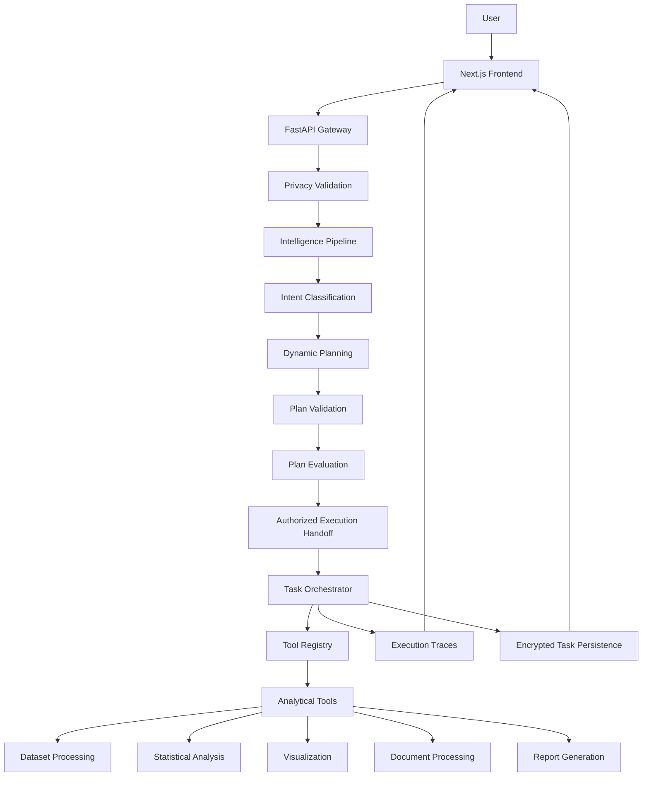

# AURA — Autonomous Understanding, Reasoning & Analytics

<p align="center">
  <strong>An Intelligent, Privacy-Aware Agentic Analytics Platform</strong>
</p>

<p align="center">
  Transform natural-language analytical requests into validated, structured, and executable workflows.
</p>

<p align="center">
  
  
  
  
  
</p>

---

## Overview

**AURA (Autonomous Understanding, Reasoning & Analytics)** is an agentic analytics platform designed to transform natural-language requests into structured analytical workflows.

Instead of requiring users to manually perform every analytical operation, AURA interprets a request, identifies the required capabilities, constructs a validated execution plan, executes registered analytical tools, evaluates the results, and produces meaningful outputs.

AURA combines LLM-assisted reasoning with deterministic execution, typed tool contracts, controlled orchestration, and privacy-aware processing.

The primary objective is to make data analysis more accessible, structured, transparent, and reliable.

## The Problem

Traditional data analytics workflows often require users to:

- Understand multiple analytical libraries and tools.
- Write Python scripts or SQL queries.
- Perform repetitive data cleaning and statistical operations.
- Manually generate visualizations.
- Interpret analytical results.
- Combine outputs into reports.
- Understand and debug complex execution pipelines.

General-purpose AI assistants can generate analytical code, but generated code may contain errors, hallucinated results, or unsafe operations.

AURA addresses these challenges through a controlled agentic architecture where reasoning and execution are separated.

## Key Features

### 1. Natural-Language Analytics

Interact with analytical capabilities using natural-language requests.

Examples:

- Inspect an uploaded dataset.
- Calculate descriptive statistics.
- Compare groups within a dataset.
- Identify correlations between numerical variables.
- Detect statistical outliers.
- Generate analytical visualizations.
- Create reports from analytical results.

### 2. Agentic Planning and Execution

AURA follows a structured workflow:

1. Understand the user's analytical intent.
2. Identify the required tools and inputs.
3. Construct a structured execution plan.
4. Validate the plan against registered tool contracts.
5. Generate an authorized execution handoff.
6. Execute the approved workflow.
7. Evaluate execution outcomes.
8. Produce safe execution traces and analytical artifacts.

The architecture separates planning, validation, authorization, execution, and evaluation.

### 3. Dynamic Analytical Workflows

AURA supports validated references between analytical steps.

For example:

`Dataset Inspection → Data Transformation → Statistical Analysis → Visualization`

Outputs from an earlier step can be referenced by downstream steps through structured references.

This enables multi-step workflows without requiring users to manually pass every intermediate result.

### 4. Data Transformation

AURA includes a structured transformation engine supporting:

- Row filtering.
- Column selection.
- Missing-value handling.
- Duplicate removal.
- Column renaming.
- Data-type conversion.

Transformations are performed through validated operations rather than arbitrary user-generated code.

### 5. Statistical Analysis

Available analytical capabilities include:

| Tool | Purpose |
|---|---|
| Dataset Inspection | Inspect dataset structure and quality |
| Descriptive Statistics | Calculate statistical summaries |
| Group Comparison | Compare metrics across groups |
| Correlation Analysis | Analyze numerical relationships |
| Outlier Detection | Identify potential anomalous observations |
| Data Transformation | Apply validated dataset transformations |
| Chart Generation | Generate analytical visualizations |
| Report Generation | Synthesize analytical outputs into reports |

Additional platform tools include document processing, document search, web research, and system health inspection.

### 6. Intelligent Model Routing

AURA uses a provider abstraction layer to separate reasoning logic from individual model providers.

The architecture supports:

- Configured cloud reasoning providers.
- Deterministic local planning paths.
- Hybrid privacy-aware processing.
- Provider availability and structured-response handling.
- Explicit provider identification in execution traces.

Model and tool selection are designed to follow the requirements of the task and the configured privacy mode.

### 7. Privacy-Aware Execution

Privacy is an important architectural consideration.

AURA incorporates:

- Local-only outbound HTTP restrictions.
- Hybrid-mode data redaction and controlled external communication.
- Encrypted storage for sensitive application data.
- Encrypted task state and checkpoint persistence.
- Validated file access.
- Restricted artifact handling.
- Privacy-aware execution traces.
- Explicit tool authorization.

The platform is designed to minimize unnecessary exposure of user data during analytical execution.

### 8. Execution Observability

AURA provides visibility into the execution lifecycle through structured traces.

Execution information includes:

- Intent classification.
- Selected reasoning provider.
- Tool execution status.
- Step-level outcomes.
- Retry information.
- Typed failure categories.
- Execution duration.
- Safe artifact summaries.

Sensitive objectives, raw tool arguments, file paths, and raw analytical outputs are excluded from the safe execution trace representation.

### 9. Interactive Workspace

The frontend provides a centralized interface for interacting with the platform.

Core sections include:

- Dashboard
- Agent Workspace
- Execution Inspector
- Model Registry
- Tool Registry
- Settings

The interface is designed around a clean monochromatic visual system with an animated startup experience.

---

## System Architecture

AURA follows a layered architecture that separates the frontend, API layer, intelligence pipeline, orchestration, tools, and persistence.



### Architectural Principles

**Separation of reasoning and execution**

LLMs help interpret and plan tasks, while deterministic tools perform controlled analytical operations.

**Validated execution**

Plans and tool arguments are checked against registered contracts before execution.

**Explicit authorization**

Execution requires a validated handoff and task-scoped authorization.

**Privacy by design**

Data access, outbound communication, persistence, and execution traces follow privacy restrictions.

**Observability**

Execution is designed to be inspectable without exposing sensitive task information.

---

## Technology Stack

| Layer | Technologies |
|---|---|
| Frontend | Next.js, React, TypeScript |
| Styling | Tailwind CSS |
| Backend | Python, FastAPI |
| Data Processing | Pandas, NumPy |
| Statistical Analysis | Python analytical libraries |
| Visualization | Matplotlib |
| Validation | Pydantic |
| Persistence | SQLite |
| Encryption | Fernet-based encryption |
| AI Integration | Provider abstraction, Gemini integration |
| Execution | Async orchestration, structured tool registry |
| Deployment | Vercel frontend, separately hosted backend |

---

## Project Structure

The repository is organized into frontend and backend applications.

```text
aura/
│
├── frontend/
│   ├── app/
│   │   ├── page.tsx
│   │   ├── layout.tsx
│   │   ├── workspace/
│   │   ├── inspector/
│   │   ├── models/
│   │   ├── tools/
│   │   └── settings/
│   │
│   ├── components/
│   │   └── StartupLoader.tsx
│   │
│   ├── public/
│   │   ├── aura-startup.mp4
│   │   └── ...
│   │
│   ├── tests/
│   ├── package.json
│   └── ...
│
├── backend/
│   ├── app/
│   │   ├── api/
│   │   ├── agent/
│   │   ├── intelligence/
│   │   ├── tools/
│   │   ├── similarity/
│   │   ├── security/
│   │   └── ...
│   │
│   ├── tests/
│   └── ...
│
├── AURA_AUDIT/
│
└── README.md
```

*Note: This is a high-level structural overview. Refer to the repository for the complete and current directory structure.*

---

## Getting Started

### Prerequisites

Make sure the following are installed:

- Node.js and npm.
- Python 3.11 or a compatible version supported by the backend.
- Git.
- A configured AI provider API key if cloud reasoning is required.

### 1. Clone the Repository

```bash
git clone https://github.com/ArtsWallah/aura.git

cd aura
```

### 2. Set Up the Frontend

```bash
cd frontend

npm install
```

Start the development server:

```bash
npm run dev
```

The frontend will generally be available at:

```text
http://localhost:3000
```

### 3. Set Up the Backend

Open another terminal:

```bash
cd backend
```

Create a virtual environment:

```bash
python -m venv venv
```

Activate it.

Windows:

```bash
venv\Scripts\activate
```

Linux/macOS:

```bash
source venv/bin/activate
```

Install dependencies using the repository's dependency file:

```bash
pip install -r requirements.txt
```

Start the FastAPI application using the backend's configured ASGI entry point.

For example, if the application entry point is `app.main:app`:

```bash
uvicorn app.main:app --reload
```

The backend will generally be available at:

```text
http://127.0.0.1:8000
```

Check the actual application entry point and configuration before running this command.

### 4. Environment Configuration

Create the required local environment files based on the repository's configuration.

Typical configuration categories include:

- Backend API configuration.
- AI provider credentials.
- Encryption key configuration.
- Database and persistence settings.
- CORS and allowed-origin settings.
- Privacy mode configuration.

**Important:** Never commit API keys, encryption keys, database files, or other secrets to GitHub.

Do not generate a new encryption key for an existing encrypted deployment without understanding the consequences. Losing the original key can make encrypted data unrecoverable.

---

## Privacy Modes

AURA is designed with multiple privacy configurations.

| Mode | Description |
|---|---|
| Local Only | Restricts outbound network communication and uses local deterministic processing paths |
| Hybrid | Uses privacy-aware processing and controlled external reasoning where permitted |
| Cloud Enabled | Allows configured cloud reasoning providers according to the application's security configuration |

The exact available capabilities depend on the configured providers and runtime environment.

---

## Security Architecture

Security controls are implemented across multiple layers.

### Network Restrictions

- Shared outbound HTTP boundaries.
- Local-only network restrictions.
- Origin and CORS validation.
- Controlled external communication.

### Data Protection

- Encrypted sensitive persistence.
- Encrypted task checkpoints.
- Managed file storage.
- Safe path validation.
- Restricted artifact access.

### Execution Security

- Strict input validation.
- Registered tool contracts.
- Dependency and cycle validation.
- Authorized execution handoffs.
- Task-scoped execution permissions.
- Bounded retries and execution timeouts.
- Cooperative cancellation.

### Trace Security

Execution traces use typed, sanitized information instead of exposing raw task data.

---

## Testing

AURA includes automated backend and frontend tests.

### Frontend Tests

```bash
cd frontend

npm test
```

Run TypeScript validation and the production build:

```bash
npx tsc --noEmit

npm run build
```

### Backend Tests

From the repository root, run:

```bash
pytest backend/tests -q
```

The project has included regression coverage for:

- Privacy enforcement.
- Encrypted persistence.
- Task lifecycle handling.
- Plan validation.
- Tool authorization.
- Execution traces.
- Artifact isolation.
- Dynamic step references.
- Dataset transformations.
- Analytical workflows.

Test counts can change as the project evolves. Run the current test suite to obtain the latest results.

---

## Deployment

### Frontend — Vercel

The Next.js frontend can be deployed through Vercel.

Recommended configuration:

| Setting | Value |
|---|---|
| Framework | Next.js |
| Root Directory | `frontend` |
| Build Command | `npm run build` |
| Output Directory | `.next` |

The frontend must be configured with the URL of the deployed backend.

### Backend — Persistent Hosting

The backend should be hosted separately in an environment that supports:

- Persistent storage.
- Long-running application processes.
- Background task execution.
- SQLite/checkpoint persistence.
- Encrypted file storage.
- Controlled network access.

**Deployment security note:** The current architecture is designed around a loopback, single-user deployment. It should not be exposed publicly as a multi-user service without additional authentication, task ownership, and production security controls.

---

## Current Capabilities and Development Roadmap

AURA is an actively evolving project.

### Implemented

- [x] Next.js frontend and FastAPI backend.
- [x] Privacy-aware request handling.
- [x] Encrypted task persistence.
- [x] Structured task lifecycle.
- [x] Dynamic intent classification and planning.
- [x] Validated execution plans.
- [x] Provider routing.
- [x] Deterministic plan evaluation.
- [x] Authorized execution handoffs.
- [x] Task-scoped tool authorization.
- [x] Safe execution traces.
- [x] Dataset inspection and statistical analysis.
- [x] Data transformation operations.
- [x] Dynamic references between workflow steps.
- [x] Chart and report generation.
- [x] Document processing and research tools.
- [x] Interactive dashboard and workspace.
- [x] Video-based startup loader.

### Future Development

- [ ] More advanced adaptive workflow planning.
- [ ] Additional analytical transformation tools.
- [ ] More advanced dataset operations and joins.
- [ ] Improved semantic document retrieval.
- [ ] Production-grade multi-user authentication and authorization.
- [ ] Distributed task execution.
- [ ] Enhanced interactive analytical visualizations.
- [ ] More model integrations and deployment options.

---

## Design Philosophy

AURA is built around five core principles:

1. **Reasoning before execution** — understand and validate the task before running analytical operations.
2. **Deterministic wherever possible** — use controlled tools for calculations and data processing.
3. **Privacy by default** — minimize unnecessary data exposure.
4. **Transparency** — provide visibility into execution and outcomes.
5. **Modularity** — make it possible to extend tools, providers, and analytical capabilities independently.

---

## Contributing

Contributions and suggestions are welcome.

If you want to contribute:

1. Fork the repository.
2. Create a feature branch.
3. Make a focused change.
4. Add or update relevant tests.
5. Verify the frontend and backend.
6. Submit a pull request with a clear description.

Please avoid committing secrets, local databases, uploaded user data, or generated runtime artifacts.

---

## Limitations

AURA is an evolving platform, and some capabilities have deployment or architectural constraints.

- The current deployment architecture is intended for a single-user environment.
- Multi-user authentication and task ownership require additional implementation before public production use.
- Some model registry entries describe intended capabilities rather than fully integrated neural models.
- Browser-side hardware acceleration should not be assumed for every analytical operation.
- Background task processing and persistent storage require appropriate backend hosting.
- Cloud reasoning requires provider credentials and correct privacy configuration.

These limitations are important when evaluating the project for production deployment.

---

## Project

**AURA — Autonomous Understanding, Reasoning & Analytics**

Built to explore how agentic AI, deterministic analytical tools, and privacy-aware orchestration can work together to create more reliable data analytics workflows.

**Repository:** https://github.com/ArtsWallah/aura

---

<p align="center">
  <strong>Think. Plan. Analyze. Execute.</strong>
  <br/>
  <sub>Making analytics more accessible through controlled agentic intelligence.</sub>
</p>
